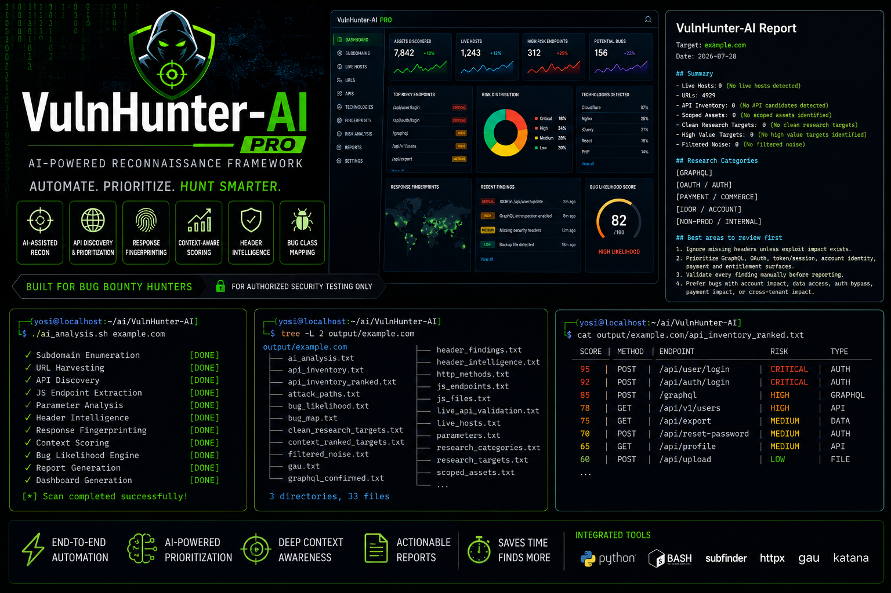
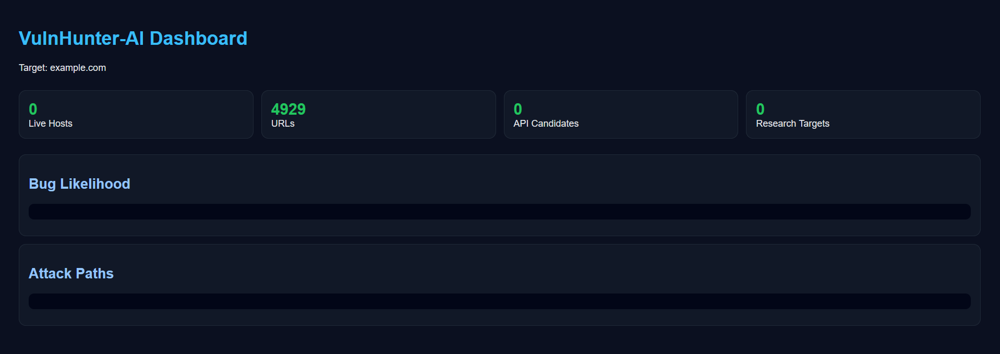
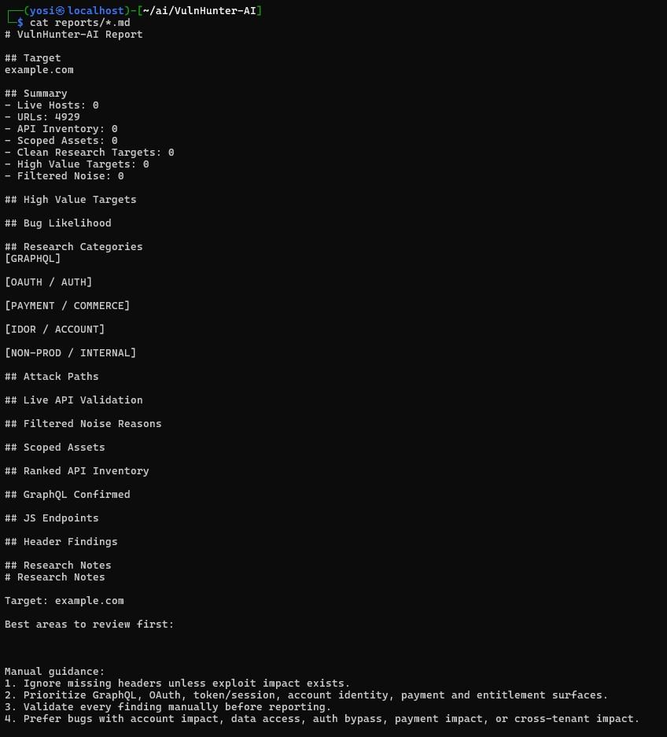
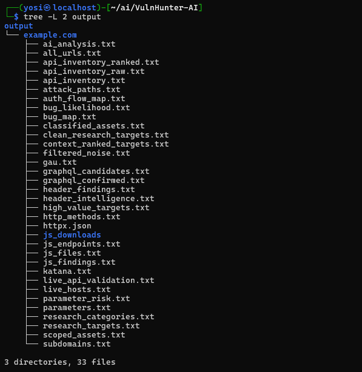
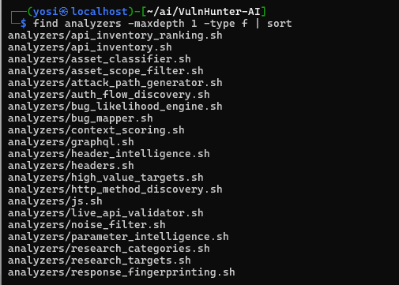

# VulnHunter-AI Community

<p align="center">

</p>

<p align="center">


</p>

Free open-source reconnaissance framework for **authorized** Bug Bounty, penetration testing and security research.

Use the Community Edition to collect and organize reconnaissance data, then upgrade to Pro for advanced rule-based prioritization, ranking, validation workflows, dashboard generation, and richer research outputs.

## Pro Edition

**VulnHunter-AI Pro v1.0.1 — $30**

https://yosiismalov.gumroad.com/l/vulnhunter-ai-pro?utm_source=github&utm_medium=community_repo&utm_campaign=v1_0_1

**Security Research Tools Storefront:** https://yosiismalov.gumroad.com/

**Free Bug Bounty Wordlists Starter Pack:** https://yosiismalov.gumroad.com/l/bug-bounty-wordlists-starter?utm_source=github&utm_medium=vulnhunter_repo&utm_campaign=starter_pack

---

# Features

- Subdomain Enumeration
- Live Host Discovery
- URL Collection
- JavaScript Endpoint Extraction
- GraphQL Discovery
- HTTP Header Analysis
- API Inventory
- Markdown Reports

---

# Community vs Pro

| Feature | Community | Pro |
|----------|:---------:|:---:|
| Subdomain Enumeration | ✅ | ✅ |
| Live Host Discovery | ✅ | ✅ |
| JavaScript Analysis | ✅ | ✅ |
| GraphQL Discovery | ✅ | ✅ |
| Header Analysis | ✅ | ✅ |
| API Inventory | ✅ | ✅ |
| Markdown Reports | ✅ | ✅ |
| Rule-based Research Guidance | ❌ | ✅ |
| HTML Dashboard | ❌ | ✅ |
| API Ranking | ❌ | ✅ |
| Bug Likelihood Scoring | ❌ | ✅ |
| Context Scoring | ❌ | ✅ |
| Attack Path Generation | ❌ | ✅ |
| Authentication Flow Discovery | ❌ | ✅ |
| Parameter Intelligence | ❌ | ✅ |
| Response Fingerprinting | ❌ | ✅ |
| Live API Validation | ❌ | ✅ |

> Pro rankings and research leads are heuristic outputs for manual investigation. They are not confirmed vulnerabilities.

---

# Screenshots

## Dashboard



---

## Markdown Report



---

## Output Structure



---

## Module List



---

# Demo Video

▶ **Watch the demo directly on GitHub**

[Demo Video](assets/video/demo.mp4)

---

# Installation

```bash
git clone https://github.com/yosiismalov/VulnHunter-AI-Community.git

cd VulnHunter-AI-Community

chmod +x vuln_hunter.sh
chmod +x check_install.sh
chmod +x recon/recon.sh
chmod +x analyzers/*.sh
chmod +x reports/report.sh

./check_install.sh
```

---

# Usage

```bash
./vuln_hunter.sh example.com
```

---

# Output

Reports

```text
reports/example.com_report.md
```

Results

```text
output/example.com/
```

---

# Upgrade to VulnHunter-AI Pro

Pro extends the Community workflow with:

- Rule-based research guidance
- HTML Dashboard generation
- API ranking
- Attack Path Generation
- Context Scoring
- Bug Likelihood Scoring
- Parameter Intelligence
- Authentication Flow Discovery
- Response Fingerprinting
- Live API Validation

The current v1.0.1 analysis layer is deterministic and rule-based. It does not invoke an external LLM or machine-learning model.

## Get Pro

https://yosiismalov.gumroad.com/l/vulnhunter-ai-pro?utm_source=github&utm_medium=community_repo&utm_campaign=v1_0_1

More tools: https://yosiismalov.gumroad.com/

---

# Disclaimer

This project is intended **only for authorized security testing**.

Always follow the rules of the Bug Bounty program or written authorization before scanning any target.

Automated outputs are research leads and require manual validation before reporting.

---

# License

MIT License
